# Haven

A self-hosted home dashboard that runs as a single Docker app, with no Home Assistant needed. It brings your
sensors, controls, lighting, air, water and power into one live, Material 3 dashboard, with automations,
history and UPS monitoring.

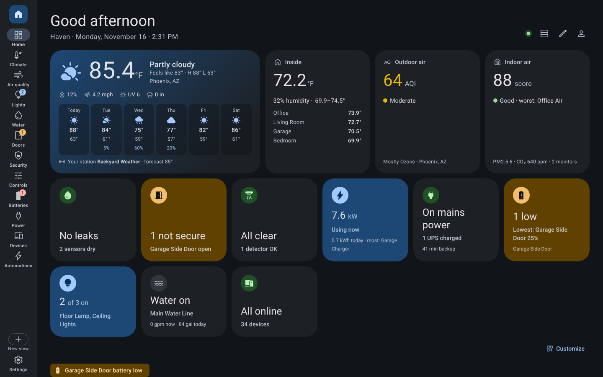

| | |
|---|---|
| 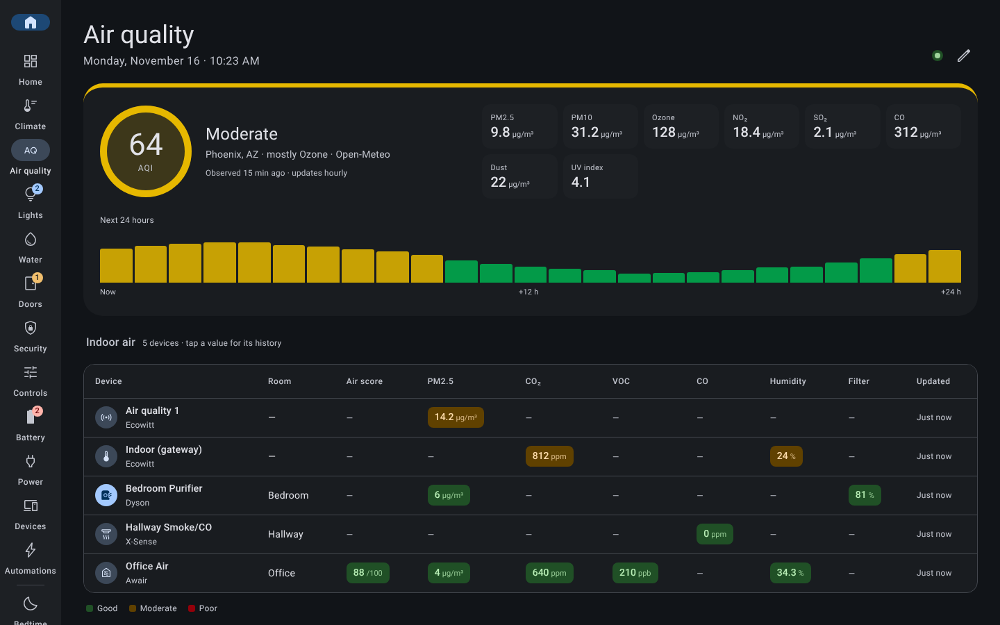 | 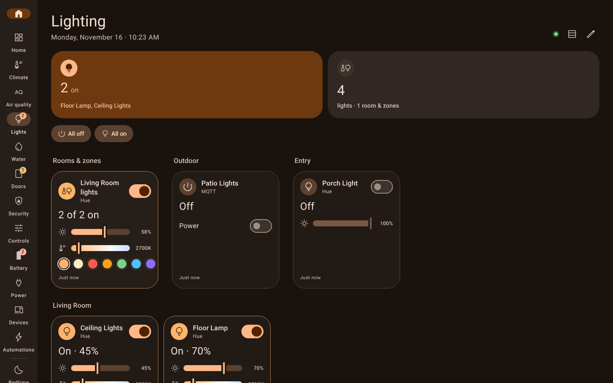 |
| 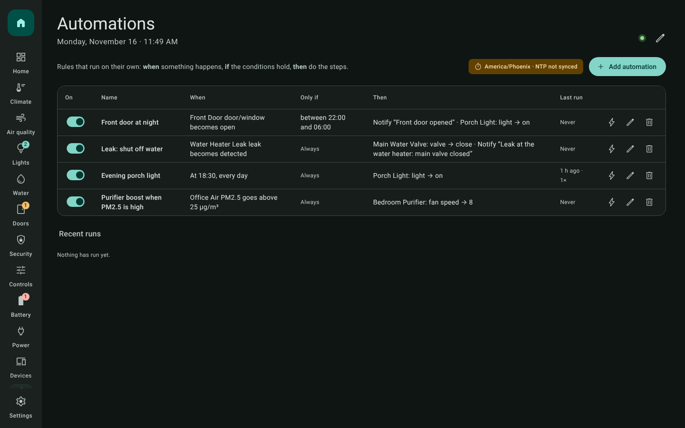 | 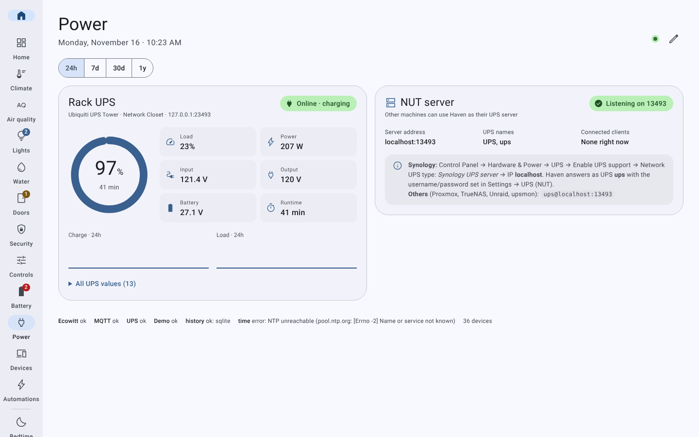 |
| 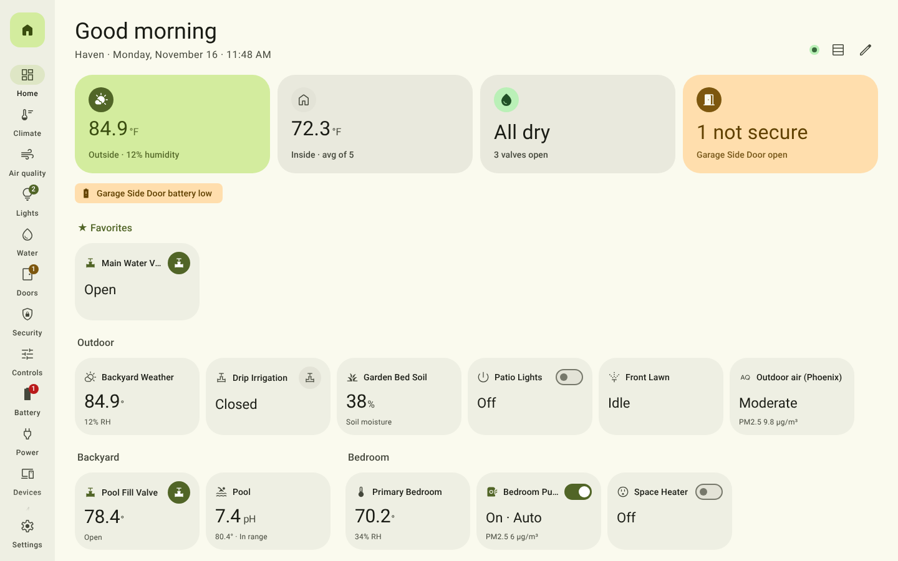 | 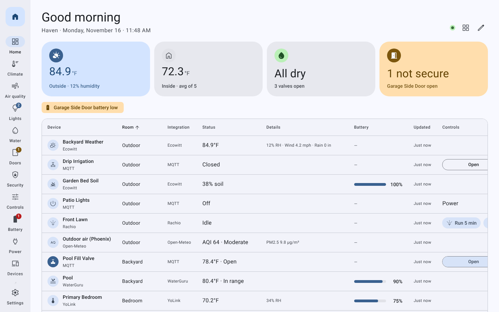 |
| 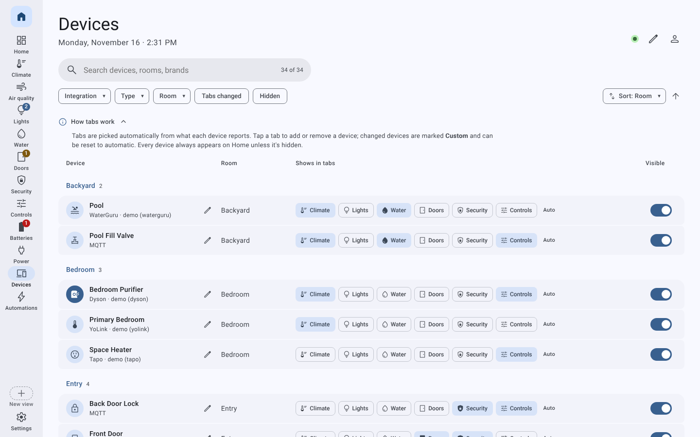 | 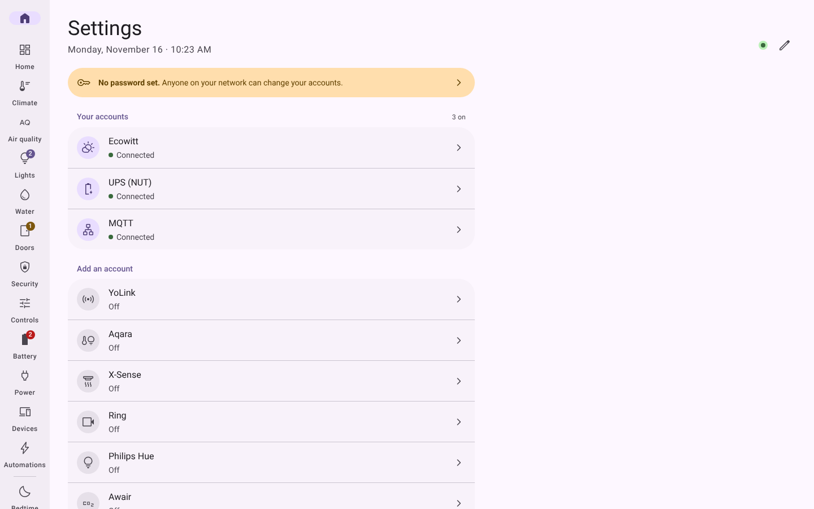 |

<p align="center">
  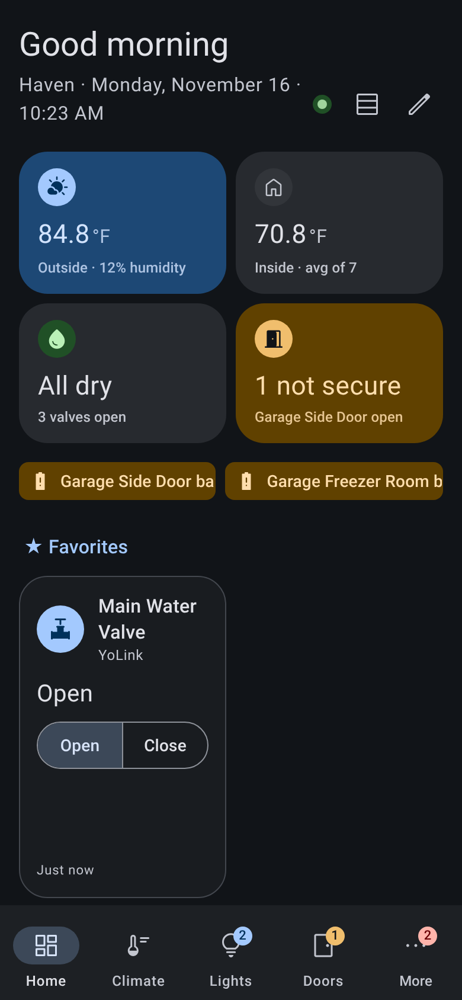
  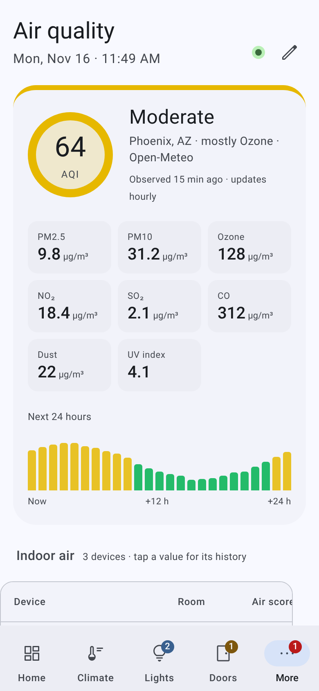
  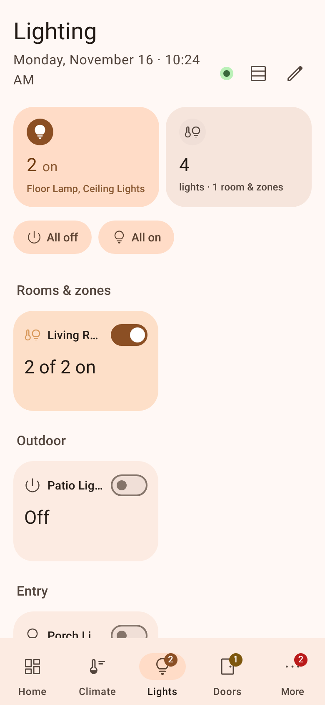
  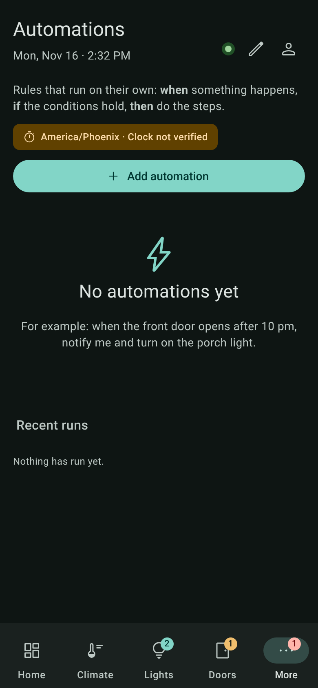
</p>

**Integrations**

| Area | Brands |
|---|---|
| Sensors and security | YoLink, Aqara, X-Sense, Ring (doorbells, cameras, floodlights), anything on MQTT (Zigbee2MQTT, ESPHome, Tasmota, Shelly, ring-mqtt) |
| Weather and climate | Ecowitt, Awair, outdoor AQI by ZIP code (Open-Meteo or EPA AirNow) |
| Air purifiers | Dyson, Levoit (VeSync) |
| Water | Flo by Moen (shutoff valve, flow, leak pucks), Rachio (irrigation), WaterGuru (pool chemistry) |
| Lighting | Philips Hue, MQTT lights |
| Power and vehicles | UniFi UPS and any NUT server, TP-Link Tapo smart plugs and power strips (with energy monitoring), ChargePoint (EV charger) |
| Appliances | Roborock (robot vacuums) |
| Standards and hubs | Matter (plugs, lights, sensors, locks, blinds… through the open-source Matter server, shared from Apple Home, Google Home, Alexa, SmartThings or Home Assistant) |

Setup guides: [water](docs/integrations/water.md) · [air](docs/integrations/air.md) ·
[outdoor air quality](docs/integrations/airquality.md) · [Tapo plugs](docs/integrations/power.md) · [EV charger and vacuum](docs/integrations/mobility.md) ·
[Matter](docs/integrations/matter.md) · [automations](docs/automations.md)

```
 Cloud APIs ─────(YoLink, Aqara, X-Sense, Ring, Flo, Rachio, WaterGuru, VeSync, ChargePoint, Roborock)─┐
 Local devices ──(Hue bridge, Ecowitt push, Awair local API, Dyson local MQTT, UniFi UPS NUT, Tapo)────┤
 MQTT broker ────(Home Assistant discovery + manual topics)────────────────────────────────────────────┤
 Outdoor AQI ────(Open-Meteo / AirNow, hourly)─────────────────────────────────────────────────────────┤
                                                                                                       ▼
        Hub ──► REST + WebSocket ──► Web dashboard (Material 3)      Automations engine (rules, schedules)
         │                                                           NTP-corrected clock + time zone
         └──► History: SQLite / Prometheus  ·  /metrics
```

## Quick start

Haven ships as a multi-arch image (Intel/AMD + ARM64) built by GitHub Actions on every push:
**`ghcr.io/ryanbyte1701/haven:latest`**.

```bash
mkdir haven && cd haven && mkdir data
curl -O https://raw.githubusercontent.com/ryanbyte1701/haven/main/docker-compose.yml
# edit docker-compose.yml: `user:` (run `id`; Synology is usually 1026:100), DASH_TOKEN password, TZ
docker compose up -d
```

Open `http://<docker-host>:1701` (or `https://<docker-host>:1702`, self-signed until you add your own certificate), go to **Settings**, and switch on your accounts. Each card says where to
find the keys, and Ring, Aqara and Hue have a guided **Sign in / Pair** button. Settings are saved to
`data/settings.json` and take effect immediately. Update with `docker compose pull && docker compose up -d`.

**Synology NAS:** see [SYNOLOGY.md](SYNOLOGY.md) for step-by-step Container Manager setup.

**From source:** `git clone https://github.com/ryanbyte1701/haven`, then in `docker-compose.yml` swap the
`image:` line for `build: .`. Prefer files over the Settings page? Every option is documented in
`config/config.example.yaml`; copy it to `config/config.yaml` (Settings values win over the file).

**Settings** is a short list: your accounts with a one-line status (Connected, Off, Needs sign-in, Problem),
then Dashboard (Appearance, History & metrics) and Security. Tap a row for that integration's page: an on/off
switch, collapsible setup steps, its fields, and rarely-needed options under *Advanced*.

## Air quality, automations and time

- **Air quality tab:** outdoor AQI for your ZIP code (Settings → Outdoor air quality; Open-Meteo needs no key, EPA AirNow
  needs a free key), refreshed hourly, with PM2.5, PM10, ozone, NO₂, SO₂, CO, dust and UV, and a 24-hour forecast colored by
  EPA category. Below it, one table of every air reading from every device (Awair, purifiers, Ecowitt PM2.5/CO₂, smoke/CO
  alarms), shaded good/moderate/poor, with history a tap away, and your purifiers with their controls.
- **Automations:** rules of the form *when* something happens (a device changes, a time of day, every N minutes), *only if*
  conditions hold (time window, days, another device's state), *then* do steps (control a device, notify, wait, call a
  webhook). Each rule has a run-now button, a cooldown and a run log. See [docs/automations.md](docs/automations.md).
- **Date & time:** Settings → Date & time sets the time zone, 12/24-hour format and NTP servers. Haven checks its clock
  against NTP and uses the corrected time for automations; a container can't change the host clock, so the drift is shown.
- **Device panel:** tap a device's name (or *More controls*) for every reading, every control and tap-for-history tiles.
  Cards stay the same height by showing the most important things first.

## Brands

| Brand | Setup (all in Settings) | Updates |
|---|---|---|
| **YoLink** | YoLink app → Settings → Account → Advanced Settings → **User Access Credentials** → UAID + Secret Key | Instant (YoLink MQTT), plus a full refresh every 15 min |
| **Aqara** | developer.aqara.com project → App ID, App Key, Key ID → **Sign in** (code is sent to your Aqara account) | Polled every 60 s. Tokens refresh automatically |
| **Ecowitt** | Gateway → Weather Services → **Customized**: Ecowitt protocol, server = Haven's IP, port 1701, path = the secret path from Settings → Ecowitt (or approve the gateway there), interval 60 s | Every push from the gateway |
| **X-Sense** | A **second** X-Sense account your devices are shared to (one login per account) | Polled every 2 min |
| **Ring** | **Sign in** with email, password and the verification code Ring sends | Motion and doorbell presses are instant (push). Battery and settings are polled |
| **Philips Hue** | Enter the bridge IP (or let Haven find it) → **Pair bridge** → press the bridge's link button | Instant (bridge event stream), runs locally |
| **UPS (NUT)** | UniFi Network → the UPS → Settings → enable **NUT Server**, then add its IP in Haven | Every 5 s |
| **Awair** | Awair app → Awair+ → Developer Option → enable Local API, then add each monitor's IP (or a cloud token) | Every 60 s (local) |
| **Dyson** | **Sign in** (email, password, emailed code), then add each purifier as `SERIAL=IP` | Live (local MQTT) |
| **Levoit (VeSync)** | VeSync email and password | Every 60 s |
| **TP-Link Tapo plugs** | Tapo app email and password, plus each plug's IP address | Every 30 s, locally |
| **Flo by Moen** | Flo/Moen email and password | Every 60 s, and right after commands |
| **Rachio** | API key from app.rach.io → Account settings → GET API KEY | Every 5 min (Rachio's rate limit), and after commands |
| **WaterGuru** | WaterGuru email and password | Every 15 min |
| **ChargePoint** | **Sign in** with your ChargePoint account | Every 60 s |
| **Roborock** | **Sign in** with your Roborock email (code sent by email) | Live where the vacuum allows local control |
| **Outdoor air quality** | Your ZIP / postal code; AirNow also needs a free API key | Hourly |
| **Matter** | Run the bundled Matter server container (host networking, IPv6 on), then paste a device's pairing code from Apple Home / Google Home / Alexa / SmartThings / Home Assistant ("share" / "pairing mode") and press **Add device**. [Guide](docs/integrations/matter.md) | Instant (Matter subscriptions), runs locally |
| **MQTT** | Broker host. Devices that publish Home Assistant discovery (Zigbee2MQTT, ESPHome, Tasmota, Shelly, ring-mqtt) appear on their own. Custom topics go in `config.yaml` | Instant |

**Tips**
- **Aqara Zigbee sensors:** pairing them to Zigbee2MQTT (instead of an Aqara hub) keeps them local and instant.
- **Ring Alarm** (contact sensors, keypad, alarm mode): run [ring-mqtt](https://github.com/tsightler/ring-mqtt) next to Haven. Its devices, including the alarm panel with Off/Home/Away, appear through MQTT.

## Controls

| Type | Supported via |
|---|---|
| Locks (lock/unlock) | YoLink Lock / LockV2, MQTT (Z2M, Z-Wave JS UI), Aqara (where the API allows), Matter |
| Valves (open/close) | YoLink valve controllers, MQTT, Aqara via resource mapping |
| Lights (on/off, brightness, color temperature, color) | Philips Hue (lights, rooms, zones), MQTT lights (Zigbee2MQTT etc.), Matter |
| Switches / outlets | YoLink outlets, Aqara relays, MQTT, Matter |
| Alarm panel (Off / Home / Away) | Ring Alarm via ring-mqtt, any MQTT `alarm_control_panel` |
| Floodlight, siren, snapshot | Ring cameras |
| Smoke alarm test / mute | X-Sense |

Locks, valves, sirens, alarm modes and alarm tests ask for confirmation before they run.

## UPS monitoring

The **Power** page shows every UPS's status, charge, runtime, load, voltages and charge/load history, read from
its NUT server (UniFi UPS Tower / UPS-2U: UniFi Network → the UPS → Settings → enable **NUT Server**), or any other
NUT server such as one on a NAS. Add as many UPSes as you have (Settings → UPS (NUT) → *Add UPS*); a NUT server
that serves several UPSes shows all of them. UPSes on battery are listed first. Haven only reads; it never sends commands to a UPS. Tapo smart plugs
with energy monitoring are listed on the same page.

## Dashboard

- **Pages:** Home, Climate, Lights, Water, Doors (contact sensors only), Security, Controls, Batteries (every battery device, lowest first) and Power (UPS and smart plugs), plus Settings.
  The desktop side bar shows them all. Phones get a bottom bar (Home, Climate, Lights, Doors, More).
- **Layouts:** **Cards** or **Table**. Switch with the icon in the top bar or under Settings → Appearance. The table can be sorted by device, room, status, battery or last update.
  All cards are the same height.
- **Material Design 3 look:** light, dark or automatic theme and five theme colors. Fonts and icons are stored in the container, so it works offline.
  To add theme colors, see `tools/theme/`.
- **Alerts:** live updates. Rooms with an alarm sort to the top, and alarms turn cards and tiles red. Badges in the side bar count open doors, low batteries, lights on and UPS on battery.
- **History:** open any device (tap its name, *More controls*, a sparkline or a reading) and choose **History**: every
  reading charted on one time axis (hover or tap for exact values, with low/average/high), and every on/off or
  text state (door, lock, light, valve, leak, UPS status, alarm) as a timeline with how often and how long, plus
  its recent changes. 1 h to 1 y, depending on what you store.
- **Arranging:** tap ✎, then drag cards to reorder them or move them to another room, and drag room titles to reorder rooms.
  Drop cards on ★ Favorites to pin them to the top of Home. The ✎ on a card renames or hides it.
  The layout is saved on the server (`data/layout.json`), so every screen shows the same arrangement.
  Rooms with an active alarm still jump to the top.
- **Devices tab:** every device (hidden ones too) with the built-in tabs it appears in. Tabs are chosen automatically
  from what each device reports (a contact sensor goes to Doors and Security, a smart plug to Controls, and so on).
  Tap a tab to add or remove a device, for example to put a smart plug that runs lamps under Lights or take a
  mailbox sensor out of Security. Changed devices are marked *Custom* and have a reset button. You can also rename,
  move, pin and hide from here. Search, filter by integration, type, room, *Tabs changed* or *Hidden*, and sort by
  name, room, type, integration, last update or battery (grouped with counts). Every visible device still
  appears on Home. Saved per device in `data/overrides.json`.
- **Custom views:** **+ New view** in the side menu. Name it, pick an icon, then choose rooms, device types and
  brands (a device must match every group you fill in), and/or pick devices by hand. Views are saved on the
  server, so they appear on every screen; on phones they're under More. Edit or delete a view with the
  sliders button at the top of its page.
- **Card styles:** *Standard* (readings, sparkline, full controls) or *Minimal* (compact tiles with a one-tap control),
  chosen under Settings → Appearance for each screen.

## History & metrics

Readings are kept for charts according to **Settings → History & metrics** (or `history:` in `config.yaml`):

| Backend | Keeps | Needs |
|---|---|---|
| `sqlite` (default) | `retention_days` (default 365) in `data/history.db` | nothing |
| `memory` | last 24 h, lost on restart | nothing |
| `prometheus` | whatever Prometheus retains (`PROM_RETENTION`, default 1y) | the optional `prometheus` service |

Numeric values are saved at most every `sample_seconds` (default 60). On/off states (doors, locks, leaks,
valves, UPS status) are saved as numbers the moment they change, so they can be charted and alerted on.

Haven always publishes current values at **`/metrics`** in Prometheus format (`haven_value`,
`haven_device_online`, `haven_battery_percent`, `haven_ups_*`, `haven_last_update_timestamp_seconds`).
To run the bundled Prometheus: `docker compose --profile metrics up -d`. It scrapes Haven every 30 s using
`prometheus/prometheus.yml`. Set a **/metrics bearer token** in Settings to protect the endpoint, and put the
same token in `prometheus/prometheus.yml`. You can point Grafana at `http://<host>:9090` for dashboards.

## Security

- **Accounts and roles:** everyone signs in with a username and password. **Admin** = full control (settings,
  integrations, automations, users); **Regular** = can control devices but change no settings; **Monitor** = view
  only (no controls, no cameras, never sees settings). Admins manage people in Settings → Users & access.
  *Allow viewing without signing in* gives anyone on your home network a "Continue as viewer" (Monitor) button.
  Passwords are stored as scrypt hashes in `data/users.json`; sign-ins last 30 days of inactivity and end when the
  password or role changes. Wrong passwords are answered more and more slowly (the right one always works), and
  passwords/tokens are never put in URLs or logs.
- **First run:** with no accounts, the page asks you to create the admin account. It needs the one-time **setup code**
  printed in the container log, and only works from your home network. Until then Haven is view-only.
- **Upgrading from `DASH_TOKEN`:** your old password becomes user **`admin`**'s password (sign in as `admin`), and
  viewing without signing in starts **off**. Scripts can keep sending `Authorization: Bearer <DASH_TOKEN>` (admin).
- **Host names:** Haven only answers to IP addresses and LAN names (`diskstation`, `*.local`, `*.lan`, `*.home.arpa`).
  This stops a malicious website from reaching Haven through your browser (DNS rebinding). Opening it by your own
  domain or through a reverse proxy? Add the name to `HAVEN_ALLOWED_HOSTS` (`X-Forwarded-Host` is ignored; let the
  proxy pass the original `Host` header).
- **Stored credentials:** they live in `data/settings.json` with owner-only permissions, and are never sent back to the
  browser. API keys and passwords are removed from error messages and logs.
- **HTTPS:** built in on port 1702 with a self-signed certificate (its fingerprint is in the container log); use your
  own with `HAVEN_TLS_CERT`/`HAVEN_TLS_KEY`, and `HAVEN_HTTPS_ONLY=1` to redirect HTTP. See [SYNOLOGY.md](SYNOLOGY.md#9-https--remote-access).
- **Remote access:** don't expose ports 1701/1702 to the internet. Use a reverse proxy with HTTPS, Tailscale or a VPN.
- **Ecowitt:** gateways can't send a password, so Haven only listens to gateways you trust: point the gateway at the
  secret path shown in Settings → Ecowitt (trusted automatically), or approve it there when it first reports.
  Reports from anything else are ignored, and pushes are size- and rate-limited.
- **Automations:** a rule where an Ecowitt or MQTT sensor (which anyone on your network could fake) unlocks a door,
  disarms the alarm or opens a valve has to be confirmed with *Allow anyway*, and every automated unlock/disarm/open
  sends a notification.
- **MQTT:** the bundled broker allows anonymous access but isn't published outside Docker. Add a password file
  (see `mosquitto/mosquitto.conf`) before publishing port 1883.
- **Container:** read-only filesystem, no Linux capabilities, `no-new-privileges`; Prometheus is bound to the NAS itself.

## High availability (beta)
Two NASes, one active and one on standby, sharing a virtual IP that you set in Settings → System → High
availability. The standby takes over within about 10 s when the active Haven stops answering, copies its
settings, and keeps integrations and automations stopped until it's needed. Needs host networking and
NET_ADMIN/NET_RAW: use `deploy/synology/docker-compose.ha.yml`. Setup, failover testing and limitations:
[SYNOLOGY.md → High availability](SYNOLOGY.md#11-high-availability-beta). Code: `app/ha.py`.

## API

```
GET   /api/health
GET   /api/devices
GET   /api/devices/{id}/history?range=24h        every chartable reading/state of a device
GET   /api/devices/{id}/history/{capability}?range=1h|24h|7d|30d|1y
GET   /api/history/info            active history backend and available ranges
POST  /api/devices/{id}/command    {"capability": "valve", "value": "close"}
PATCH /api/devices/{id}            {"name": "...", "room": "...", "hidden": false}
GET   /api/layout                  PUT /api/layout {"rooms": [...], "order": {room: [ids]}, "pinned": [ids]}
GET   /api/settings                integrations, fields and status (secrets masked)
PUT   /api/settings/{section}      {"enabled": true, "values": {...}}  saves + restarts that integration
GET   /api/ha/status               high availability: state, VIP, peer, last heartbeat, recent changes
POST  /api/ha/failover             {"action": "handover" | "takeover"}  (admin)
POST  /api/settings/ring/login     {"email","password","code"?}
POST  /api/settings/aqara/login    {"account","code"?}
GET   /api/settings/hue/discover   POST /api/settings/hue/pair {"host"}
GET   /api/ring/{id}/snapshot      JPEG
GET   /metrics                     Prometheus exposition (own optional bearer token)
WS    /ws                          snapshot + live device updates
POST  /data/report[/<secret>]      Ecowitt push (only trusted gateways are listened to)
```

## Adding a brand

Create `app/adapters/<brand>.py` with a subclass of `Adapter` that calls `hub.upsert_device()` and
`hub.set_values()`, and implement `command()` for controls. At the bottom of the module define
`ADAPTER = MyAdapter` and `SETTINGS = {...}` (its Settings section); integrations register themselves, so no
other file needs editing. Add any extra packages to a file under `requirements/`. For a sign-in with an emailed
code, add `"login": True, "login_fields": [...]` to `SETTINGS` and a `signin()` classmethod.

## What's been tested

- **Tested end to end:** Ecowitt, MQTT (discovery, manual topics, lights, alarm panel), UPS monitoring over NUT (against a simulated UniFi UPS, including power loss and recovery), history storage, `/metrics`, automations (rules firing from real device changes, run log, notifications), the Settings page and the whole UI at desktop and phone sizes.
- **Written against each vendor's published API or the maintained library Home Assistant uses, and tested with recorded/mocked responses, but not yet run with real accounts:** YoLink, Aqara, X-Sense, Ring, Philips Hue, Awair, Dyson, Levoit/VeSync, Tapo, Flo, Rachio, WaterGuru, ChargePoint, Roborock and the outdoor AQI services.
  Check `docker logs haven` on first run, and each integration's status line in Settings.

Tests: `pip install -r requirements.txt pytest && pytest tests`
